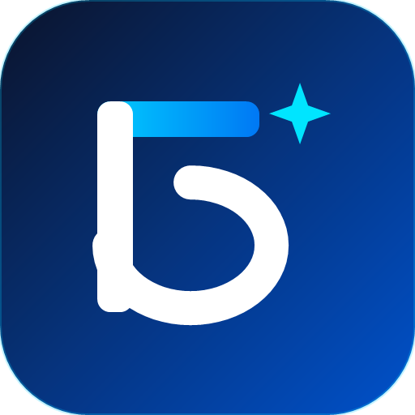

# BMSTU neo

<div align="center">



**Неофициальный клиент Личного кабинета студента МГТУ им. Н.Э. Баумана (ЛКС)**

[](https://flutter.dev)
[](LICENSE)
[]()

</div>

## Возможности

- **Расписание** группы и преподавателей: числитель и знаменатель, свайпы по дням, свои занятия,
  гостевой режим без входа.
- **Успеваемость (БРС)**: баллы по модулям и контрольным точкам, сроки ДЗ и РК по неделям,
  ручные отметки «сдано» / «выдано», результаты сессий.
- **Физкультура (ФКиС)**: баллы, посещения, ближайшее занятие.
- **Студенческий** и QR-пропуск.
- **Уведомления** о новых баллах, выданных заданиях и сроках на этой неделе. Приложение
  проверяет ЛКС в фоне со своей сессией; сервер только будит его тихим push.
- **Виджет** на рабочий стол (Android и iOS) и **Live Update** с текущей парой (Android).
- **Офлайн-режим**: расписание и оценки кэшируются.
- **Material You**, светлая и чёрная тёмная тема, крупный шрифт.

Пароль хранится только на устройстве (Keychain / Keystore) и отправляется только на SSO МГТУ.
Подробно — в [политике конфиденциальности](PRIVACY_POLICY.md).

## Структура репозитория

```text
app/
├── lib/
│   ├── models/          модели данных (расписание, профиль, БРС, ФКиС)
│   ├── providers/       состояние (Provider)
│   ├── screens/         экраны, включая настройки
│   ├── services/        клиент ЛКС, кэш, фоновая синхронизация, push, виджет
│   └── widgets/         компоненты интерфейса
├── android/             нативная часть: виджет, Live Update, FCM
├── ios/                 нативная часть: WidgetKit, APNs
├── macos/
├── assets/              иконки и шрифт Onest
├── test/                тесты (flutter test)
├── tool/                утилиты: обновление каталога групп, тестовые push
├── server/              сервер тихих push-уведомлений (Dart) — см. server/README.md
├── docs/                проектная документация
├── codemagic.yaml       сборка iOS и выгрузка в TestFlight
└── .github/workflows/   CI: анализ и тесты
```

Лендинг приложения живёт в отдельном репозитории (папка `website/` рядом с этой).

## Запуск

Нужен [Flutter](https://docs.flutter.dev/get-started/install) 3.x (stable), для iOS — Xcode,
для Android — Android SDK.

```bash
git clone https://github.com/aleksrovinski/bmstuneo.git
cd bmstuneo
flutter pub get
flutter run
```

Проверки (их же запускает CI):

```bash
flutter analyze
flutter test
```

### Параметры сборки

| `--dart-define` | Зачем |
|---|---|
| `PUSH_SERVER_URL=https://…` | адрес сервера push-уведомлений. Без него приложение не регистрируется на сервере, а фоновая проверка по расписанию ОС работает как обычно |

Отладочная сборка Android разрешает обычный HTTP только к `localhost`, поэтому для локального
сервера на телефоне по USB: `adb reverse tcp:8080 tcp:8080` и
`flutter run --dart-define=PUSH_SERVER_URL=http://localhost:8080`.

### Push-уведомления

- **Android**: Firebase Cloud Messaging. Конфигурация проекта — `android/app/google-services.json`
  (не секрет).
- **iOS**: APNs напрямую, capability Push Notifications и Background Modes в Xcode.
- **Сервер**: [`server/`](server/README.md). Ключ APNs (`.p8`) и сервисный аккаунт Firebase нужны
  только серверу и в репозиторий не попадают.
- Тестовая отправка без сервера: `tool/send_test_push.sh` (iOS) и `tool/send_test_fcm.sh` (Android).

Устройство и план развития — в [docs/PUSH_NOTIFICATIONS_PLAN.md](docs/PUSH_NOTIFICATIONS_PLAN.md).

## Релизные сборки

Версия и номер сборки берутся из `version:` в `pubspec.yaml` (например, `1.3.0+9`). Перед каждой
выгрузкой увеличьте число после `+`.

### Android

Релиз подписывается ключом загрузки, который хранится только локально.

1. Один раз создайте keystore (без него и пароля обновление не выпустить):
   ```bash
   keytool -genkey -v -keystore android/upload-keystore.jks -keyalg RSA -keysize 2048 -validity 10000 -alias upload
   ```
2. Скопируйте `android/key.properties.example` в `android/key.properties` и впишите пароли.

```bash
flutter build apk --release --dart-define=PUSH_SERVER_URL=https://push.example.ru
flutter build appbundle --release --dart-define=PUSH_SERVER_URL=https://push.example.ru
```

`key.properties` и `*.jks` исключены из git. На Codemagic вместо файла используются переменные
`CM_KEYSTORE_PATH`, `CM_KEYSTORE_PASSWORD`, `CM_KEY_ALIAS`, `CM_KEY_PASSWORD`. Без ключа APK
подписывается debug-ключом, а сборка AAB завершается ошибкой.

### iOS

Собирается и выгружается в TestFlight через Codemagic (`codemagic.yaml`). Настройка и
метаданные App Store — в [APP_STORE_SUBMISSION_GUIDE.md](APP_STORE_SUBMISSION_GUIDE.md).

## Участие в разработке

1. Сделайте fork и ветку: `git checkout -b feature/имя`.
2. Перед коммитом: `flutter analyze` и `flutter test`.
3. Откройте pull request.

## Лицензия

[MIT](LICENSE)
